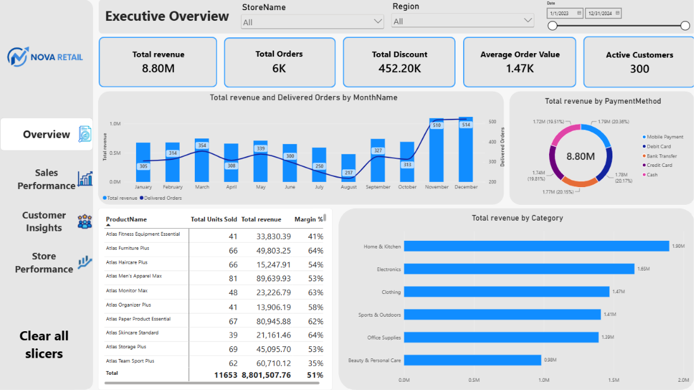

# Retail Analytics Dashboard — Power BI Practice Project

A 4-page Power BI dashboard built on a **synthetic, self-generated retail dataset** to practice data modeling, DAX, and dashboard UX/design. Not based on real company data.



## Project Purpose

Built as a portfolio/practice project to work through a full BI workflow: star-schema data modeling, DAX measures (including time intelligence), and multi-page dashboard design — from raw tables to a polished, presentable report.

## Dataset

Synthetic retail dataset generated for this project, structured as a star schema:

| Table | Rows | Description |
|---|---|---|
| Sales (fact) | 6,000 | Transactions: date, customer, product, store, quantity, price, discount, payment method, order status |
| Customers | 300 | Demographics: gender, age, city, region, segment, signup date |
| Products | 220 | Category, sub-category, brand, unit cost, unit price |
| Stores | 10 | City, region, manager |
| Calendar | 731 days (2023–2024) | Date dimension with year, quarter, month, weekday flags |

## Dashboard Pages

**1. Overview** — Executive summary: total revenue, orders, discount, AOV, active customers; monthly revenue trend, revenue by payment method, revenue by category, top 10 products by revenue.

**2. Sales Performance** — Revenue, units sold, gross margin, margin %, return rate; revenue/discount by category, order status breakdown, revenue by sub-category, full product-level detail table.

**3. Customer Insights** — New vs. active customers, revenue per customer, orders per customer, average age; customer breakdowns by gender, segment, age group, and region; new customer signups over time.

**4. Store Performance** — Revenue per store, top-performing store; revenue by store and region, payment method mix per store, full store-level detail table.

All pages share Date Range, Region, and other cross-filtering slicers for consistent interactivity.

## Key Findings

- **Total revenue: 8.80M** across 6,000 orders (300 customers, 10 stores, Jan 2023–Dec 2024), averaging 1.47K per order.
- **Home & Kitchen is the top category** (1.90M), followed by Electronics (1.65M) and Clothing (1.47M); Beauty & Personal Care is the weakest (0.98M).
- **Gross margin is 51%** overall, but varies widely by product — top SKUs range from 35% to 66% margin, meaning high revenue doesn't always mean high profitability (e.g., Fitness Equipment at 41% vs. Furniture at 64%).
- **16% return rate** — a meaningful share of completed orders, worth flagging as an area to investigate further in a real business context.
- **East region drives the most store revenue** (3.5M) vs. South, the smallest (0.9M) — a 4x gap worth digging into (store count, population, or local demand).
- **Consumer segment dominates** (68% of customers), with Small Business (17%) and Corporate (15%) as smaller but potentially higher-value segments worth separate analysis.
- **Revenue is seasonal**, dipping in mid-year (July–August) and peaking in November–December — consistent with a retail holiday pattern.

## Recommendations

- **Investigate the 16% return rate by category/product** — isolating which SKUs or categories drive most returns would clarify whether it's a quality, sizing, or expectation-mismatch issue.
- **Reallocate marketing/inventory toward Home & Kitchen and Electronics**, the two highest-revenue categories, while reviewing whether Beauty & Personal Care's lower performance is a demand issue or an under-investment issue.
- **Review pricing/cost structure for low-margin categories** (e.g., Fitness Equipment at 41%) — either renegotiate supplier costs or adjust pricing to bring margin closer to the 51% average.
- **Study the East vs. South regional gap** — before assuming South is underperforming, check store count, local population, and marketing spend per region to see if the gap is structural or an opportunity.
- **Build a targeted retention strategy for Small Business and Corporate segments** — they're a smaller share of customers but likely carry higher order values, worth a dedicated analysis of their lifetime value.
- **Plan inventory and staffing around the Nov–Dec peak and Jul–Aug dip** — stock up ahead of the holiday surge and consider promotions to smooth out the summer slowdown.

## Key DAX Measures

```DAX
Total Revenue = SUM(Sales[TotalAmount])

Total Discount = SUMX(Sales, Sales[UnitPrice] * Sales[Quantity] * Sales[DiscountPct])

Gross Margin = SUMX(Sales, (Sales[UnitPrice] - RELATED(Products[UnitCost])) * Sales[Quantity])

Margin % = DIVIDE([Gross Margin], [Total Revenue])

Return Rate = DIVIDE(
    CALCULATE([Total Orders], Sales[OrderStatus] = "Returned"),
    [Total Orders]
)

Top Store Revenue = MAXX(ALLSELECTED(Stores[StoreName]), [Total Revenue])
```

Full measure list is in the `.pbix` file.

## Skills Practiced

- Star-schema data modeling (fact/dimension tables, relationships)
- DAX: aggregations, iterators (`SUMX`, `MAXX`), `CALCULATE`/`FILTER` patterns, ratio measures with `DIVIDE`
- Multi-page report design with consistent navigation, slicers, and visual hierarchy
- Custom dashboard branding (logo, color palette, sidebar design)

## Files

- `PowerBI_Practice_Dataset.xlsx` — source data (5 sheets)
- `Retail_Analytics_Dashboard.pbix` — Power BI report
- `screenshots/` — page-by-page exports

## Author

**Ayoub Larbi** — Data Analyst / Statistical Engineer
[LinkedIn](https://linkedin.com/in/ayoublarbi) · [GitHub](https://github.com/Ayoub-LARBI)
